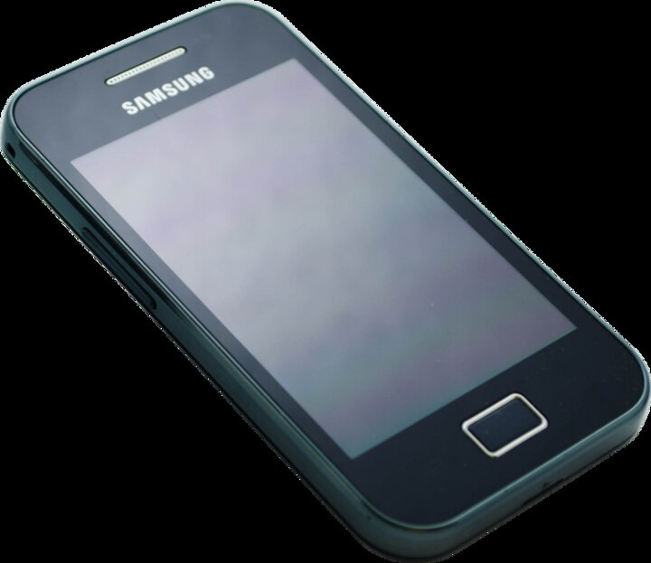

# Samsung Galaxy Ace GT-S5830/L/T (`cooper`)

*Photo: [Freddy2001](https://commons.wikimedia.org/wiki/File:Samsung_Galaxy_Ace.png), CC BY-SA 3.0, via Wikimedia Commons.*

The Galaxy Ace is a 2011 mid-range phone on Qualcomm's **MSM7227**
(ARMv6, 800 MHz) with 278 MB RAM, a 3.5" **320×480 HVGA** panel
(~165 ppi), Adreno 200, 5 MP camera, microSD and Samsung's proprietary
FSR/STL NAND stack. It shipped with Froyo and was updated to Gingerbread —
which makes it a true retro target for **Donut 1.6**, an OS older than
the hardware. GT-S5830/L/T are radio-band variants; the Broadcom-based
**GT-S5830i (`cooperve`) is a different SoC and is not supported**.

## Status

### Donut 1.6 — AOSP `android-1.6_r2` (DRD35) — boots

| Area | State |
| --- | --- |
| Boot | Full system boots to the Donut home screen (first boot 10–20 min while 32 APKs dexopt) |
| Launcher / UI | Working |
| Touchscreen | Working, incl. capacitive MENU/HOME/BACK/SEARCH via [vtouch](../../advanced/software/vtouch.md) |
| Display | Working at the measured stock density **160 dpi**, software rendering (`libagl`) |
| Audio | Speaker working (cooper msm7k HAL, no HTC acoustic dependency) |
| Buttons | HOME and power/sleep/wake working via cooper keymaps + provisioning fix |
| Storage | Internal system/data/cache on FSR/STL ext4; SD card not yet (vold disabled) |
| USB | `adb pull`/`push` (sync) working; interactive `adb shell` still fragile |
| Camera | App opens, test-pattern preview; **no live sensor feed** (kernel driver work needed) |
| WiFi | In progress — ath6kl probes the SDIO card, firmware path not yet verified on Donut boot |
| Cellular | **Not possible**: no Donut RIL library exists for MSM7227 |
| GPU | None — Donut has no Adreno 200 EGL path; software rendering only |
| BT / FM / GPS | Not started (proprietary modules/libs not integrated) |

Evidence and dates for every claim: [quirks.md](quirks.md).

**Releases:** flashable CWM/TWRP zips are published under
[GitHub Releases](https://github.com/pukikiko/retro-android-ports/releases)
— look for `full_cooper-1.6.DRD35-UNOFFICIAL-FULL-*.zip`.

## Documentation and links

- [**Device quirks**](quirks.md) — flash layout, FSR/STL, kernels, audio,
  display density, recovery interaction, bringup history.
- [Donut 1.6 porting notes](../../advanced/porting-notes/donut.md) — generic
  playbook this port produced.
- [Building Donut for cooper](../../advanced/build/donut.md).
- [Device tree](../../../devices/cooper/donut/) (`devices/cooper/donut/`) and
  [AOSP patches](../../../patches/donut/README.md) (`patches/donut/`).
- Tools used here: [vtouch](../../advanced/software/vtouch.md),
  [mkbootimg-cooper](../../advanced/software/mkbootimg-cooper.md).
