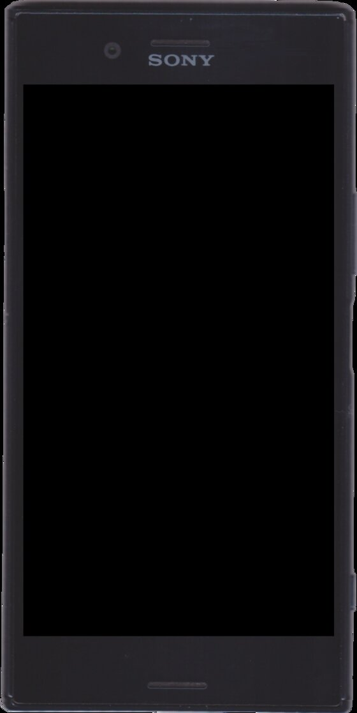

# Sony Xperia XZ Premium G8141/G8142 (`maple`)

*Photo: [Deoma12](https://commons.wikimedia.org/wiki/File:Xperia_XZ_Premium.png), CC BY-SA 4.0, via Wikimedia Commons.*

The XZ Premium is Sony's 2017 flagship on Qualcomm's **Snapdragon 835
(MSM8998)**: 4×2.45 + 4×1.9 GHz Kryo (ARM64) + Adreno 540, 4 GB RAM,
64 GB UFS, microSD, a 5.5" 3840×2160 HDR panel (rendered at 1080p /
density 410 in normal use), USB-C. It shipped with **Nougat 7.1.1**;
`maple` is the single-SIM G8141, `maple_dsds` the dual-SIM G8142. Our port
puts **KitKat 4.4.4** — a 32-bit, 2013 userspace — on it.

## Status

### KitKat 4.4.4 — AOSP `android-4.4.4_r2` (KTU84Q) — boots to UI

| Area | State |
| --- | --- |
| Boot | Boots to launcher (`sys.boot_completed=1`, 75 binder services), all partitions mounted |
| Launcher / UI | Working; sustained animations ~26–35 fps |
| Touch | Working (Clearpad, full-range coords, nav bar + gpio keys) |
| Display | Working, 1080×1920 through glrenderd as the single fb0 flipper |
| GPU | **Hardware GL/GLES 3.2 on the Adreno 540** via [glrenderd](../../advanced/software/glrenderd.md) |
| USB | adb working (configfs gadget, `18d1:4ee7`) |
| Lights | Brightness + sleep via the ported lights HAL (both backlight nodes) |
| Storage | Emulated internal storage working (`/sdcard`); microSD still untested |
| WiFi | Feature + supplicant services in place; driver loads but **no wlan0** — locator (SERVREG_LOC) now served by in-tree `pdserve` and the PDR chain (icnss) registers its notifier, but the modem root PD crashes every ~41 s before wlan_pd/WLFW can start; modem stability (keepalive/rild) is the open blocker |
| Audio | Mixer controls verified on the probing tasha card; **no audible playback yet** — stalls at PREPARED in the ADSP (`msm_pcm_playback_copy` wait timeout); protection-domain/daemon workstream |
| Cellular | No RIL library for this port — not working |
| Camera / GPS / BT / fingerprint | Not started (proprietary HALs) |

Known device quirks: rare **pre-userspace boot hang** (stuck on the Sony
splash, **zero USB** — recover with a TWRP round-trip before reflashing);
the keyguard window caps screen-off at ~10 s (stock KitKat behavior, power
key wakes); `screencap` returns a constant image on this port (dump fb0
instead). Details in [quirks.md](quirks.md).

**Releases:** maple images are built locally — no published zips yet; see
[Building KitKat for maple](../../advanced/build/kitkat.md). Cooper's zips
live under [GitHub Releases](https://github.com/pukikiko/retro-android-ports/releases).

## Documentation and links

- [**Device quirks**](quirks.md) — hardware snapshot, flash layout, the
  full TEST 1–37 bringup log, blockers and verified fixes.
- [KitKat 4.4.4 porting notes](../../advanced/porting-notes/kitkat.md) —
  generic playbook this port produced.
- [Building KitKat for maple](../../advanced/build/kitkat.md).
- [Device tree](../../../devices/maple/kitkat/) (`devices/maple/kitkat/`)
  and [AOSP patches](../../../patches/kitkat/README.md) (`patches/kitkat/`).
- Tool used here: [glrenderd](../../advanced/software/glrenderd.md).
